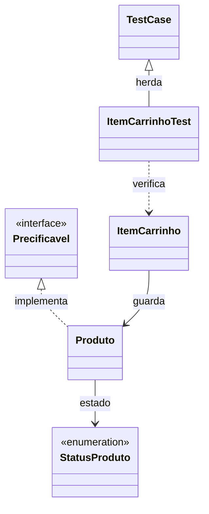

# Aula 3.22 — Revisão acompanhada de PHP moderno e OOP

## Objetivo

Relacionar os conceitos e arquivos do módulo 3, acompanhar o fluxo de uso das
classes e confirmar entendimento antes de registrar a conclusão do módulo.
Esta etapa acrescenta documentação, sem alterar o código da aplicação.

## Relações entre as classes



| Arquivo | Responsabilidade e conceitos |
| --- | --- |
| [Produto.php](../../src/Produto.php) | Guarda nome string, preço int em centavos e estado StatusProduto. Valida nome e preço, oferece getters e ações ativar/desativar. |
| [StatusProduto.php](../../src/StatusProduto.php) | Enum com os casos Ativo e Inativo, associados aos textos ativo e inativo. |
| [Precificavel.php](../../src/Precificavel.php) | Interface que exige getPrecoEmCentavos(): int. Produto declara implements e cumpre esse contrato. |
| [ItemCarrinho.php](../../src/ItemCarrinho.php) | Guarda um Produto e quantidade int positiva. Usa composição e calcula o subtotal. |
| [ItemCarrinhoTest.php](../../src/tests/ItemCarrinhoTest.php) | Herda a estrutura de TestCase por extends e verifica os comportamentos com PHPUnit. |

Uma classe define estrutura e operações; `new` cria uma instância e chama seu
construtor. `$this` representa o objeto em que o método está sendo executado.
Cada Produto guarda seu próprio estado; ItemCarrinho guarda o Produto recebido,
sem criar uma cópia.

## Tipos, regras e encapsulamento

Os tipos informam os formatos exigidos: string para nome, int para preço e
quantidade, StatusProduto para estado. `declare(strict_types=1)` aplica tipagem
estrita a chamadas escalares feitas nesse arquivo.

As validações verificam os valores:

- Nome vazio ou formado apenas pelos espaços removidos por trim é recusado.
- Preço negativo é recusado; preço zero é permitido.
- Quantidade menor que 1 é recusada; quantidade 1 é permitida.

As regras inválidas lançam InvalidArgumentException. Tipo e regra são verificações
distintas: quantidade -1 tem tipo int, mas viola a regra de quantidade positiva.
Nos exemplos usamos try/catch para tratar uma recusa; nos testes configuramos
expectException antes de executar a ação que deve lançar.

Propriedades privadas são acessadas por métodos da classe. Os parâmetros
promovidos com private no construtor declaram e preenchem essas propriedades.
Os getters devolvem dados; ativar/desativar alteram o estado e têm retorno void.

O enum limita as opções de estado. `getStatus()` devolve um caso de StatusProduto;
`->value` consulta seu texto. `StatusProduto::Ativo` é um caso do enum; `::class`,
usado no teste de exceção, fornece o nome de uma classe como string.

## Contrato, composição e herança

- `Produto implements Precificavel`: cumpre o contrato público de consulta de preço.
- ItemCarrinho guarda Produto: combina objetos por composição e usa os métodos
  públicos do produto recebido.
- `ItemCarrinhoTest extends TestCase`: recebe a estrutura de testes pela herança
  da classe base do PHPUnit, incluindo os recursos de asserção e expectativa.

## Namespaces, Composer e autoload

O namespace Loja organiza nomes como Loja\Produto. `use Loja\Produto` permite
o nome curto nesse arquivo; o carregamento dos arquivos é feito pelo autoload.

[composer.json](../../src/composer.json) declara PHP ^8.4, o mapeamento PSR-4
de Loja\ para ./ e PHPUnit ^13.4 em require-dev. [composer.lock](../../src/composer.lock)
registra PHPUnit 13.4.1 e seus 26 pacotes auxiliares em versões exatas.
`composer install` reproduz essas versões e gera o carregador no volume vendor.

`require_once "/app/vendor/autoload.php"` registra o carregador. Ao precisar de
Loja\Produto, ele encontra /app/Produto.php, montado a partir de src/Produto.php.
Os pacotes externos e os arquivos gerados de vendor permanecem no volume Docker
e fora do Git; JSON e lockfile ficam no repositório.

## Fluxo acompanhado

Executamos esta demonstração temporária pelo terminal, na raiz do projeto:

```bash
docker compose run --rm -T php php <<'PHP'
<?php

declare(strict_types=1);

use Loja\ItemCarrinho;
use Loja\Produto;

require_once "/app/vendor/autoload.php";

$produto = new Produto("Camiseta", 4990);
$item = new ItemCarrinho($produto, 3);

echo "Subtotal em centavos: " . $item->getSubtotalEmCentavos() . PHP_EOL;

$produto->desativar();
echo "Estado consultado pelo item: " . $item->getProduto()->getStatus()->value . PHP_EOL;
PHP
```

`run --rm` cria e remove o container temporário; `-T` desabilita o terminal
virtual. O primeiro php é o serviço e o segundo executa o código pela entrada
padrão. `<<'PHP'` envia o bloco sem expandir variáveis no shell.

O autoload disponibiliza as classes. `new Produto` passa nome e preço ao
construtor, que valida os valores. O estado inicial é Ativo, padrão já definido.
`new ItemCarrinho` guarda esse objeto e valida quantidade 3.

O subtotal consulta o preço do Produto e multiplica pela quantidade: 4990 x 3.
desativar atribui Inativo à propriedade do Produto. O getter do item devolve
o mesmo objeto, e a consulta de estado mostra inativo.

Saída conferida, com código 0:

```text
Subtotal em centavos: 14970
Estado consultado pelo item: inativo
```

A chamada persistente de criação do item também está em
[exemplo-item-carrinho.php](../../src/exemplo-item-carrinho.php).

## Os cinco testes atuais

| Cenário | Resultado esperado |
| --- | --- |
| Preço 4990, quantidade 3 | Subtotal inteiro 14970. |
| Preço 4990, quantidade 1 | Subtotal inteiro 4990. |
| Preço 0, quantidade 3 | Subtotal inteiro 0. |
| Quantidade 0 | InvalidArgumentException. |
| Quantidade -1 | InvalidArgumentException. |

Os métodos públicos com prefixo test são executados pelo PHPUnit. Dentro deles,
`$this` representa a instância de teste. assertSame compara esperado e obtido,
incluindo seus tipos; expectException registra o tipo de exceção esperado.

O comando disponível é:

```bash
docker compose run --rm php php vendor/bin/phpunit \
  --bootstrap vendor/autoload.php tests/ItemCarrinhoTest.php
```

O bootstrap carrega explicitamente o autoload antes do arquivo de teste.
A última execução na etapa 3.21 retornou `OK (5 tests, 5 assertions)`, código 0.
Os testes não foram repetidos nesta revisão; código e dependências permaneceram
iguais. A demonstração de composição acima foi executada nesta etapa.

## Continuidade

Entendimento da revisão confirmado com "entendi" em 12/10/2026. Módulo 3
concluído. Publicar o checkpoint de revisão e retomar o módulo 4 do roteiro.

Próxima etapa prevista, 4.1: apresentar o papel de Laravel, consultar requisitos
oficiais de Laravel 13, conferir PHP/Composer/extensões no Docker e definir a
pasta do backend preservando o laboratório src. A instalação ocorrerá em etapa
seguinte, após explicar e confirmar essa preparação.
Estado em [progresso](../progresso.md).
