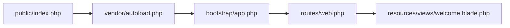

# Aula 4.2 — Obter e conhecer o esqueleto Laravel

## Objetivo

Obter o modelo oficial laravel/laravel v13.11.0 em backend e apresentar seus
arquivos antes de instalar as dependências ou executar a aplicação.

## Comando executado

Na raiz do repositório, após conferir que backend não existia:

```bash
mkdir backend
docker compose run --rm --workdir /projeto \
  --volume ./backend:/projeto/backend:rw \
  php composer create-project laravel/laravel backend v13.11.0 \
  --no-install --no-scripts --no-interaction --no-progress
```

- mkdir prepara a pasta local vazia como ponto de montagem.
- run --rm cria e remove um container temporário do serviço php existente.
- --workdir define /projeto como diretório de trabalho do comando.
- A montagem disponibiliza somente backend em /projeto/backend com escrita.
- composer create-project obtém o pacote de projeto e extrai seus arquivos.
- laravel/laravel é o modelo oficial; backend é o destino relativo a /projeto.
- v13.11.0 fixa a versão do esqueleto consultada no Packagist e no repositório oficial.
- --no-install adia as dependências; --no-scripts adia as ações automáticas do modelo.
- --no-interaction evita perguntas interativas; --no-progress omite a barra de progresso.

Resultado: pacote laravel/laravel v13.11.0 baixado e extraído, projeto criado
em /projeto/backend, código 0. Foram gerados 58 arquivos.

Esqueleto e framework são pacotes diferentes: o primeiro fornece o projeto
inicial; laravel/framework fornece a biblioteca executada pela aplicação.
O composer.json gerado declara laravel/framework ^13.17; sua versão exata
será resolvida e registrada no lockfile quando instalarmos as dependências.

## Mapa da estrutura gerada

| Local | Arquivos e papel inicial |
| --- | --- |
| app/ | Controllers/Controller.php, Models/User.php e Providers/AppServiceProvider.php: classes iniciais da aplicação. |
| bootstrap/ | app.php configura a aplicação; providers.php lista providers; cache/.gitignore preserva o diretório de arquivos gerados. |
| config/ | app, auth, cache, database, filesystems, logging, mail, queue, services e session: arquivos PHP de configuração. |
| database/ | Três migrations iniciais, UserFactory, DatabaseSeeder e .gitignore; serão estudados com persistência. |
| public/ | index.php, .htaccess, favicon.ico e robots.txt: entrada HTTP e arquivos públicos. |
| resources/ | views/welcome.blade.php, css/app.css e js/app.js: apresentação e fontes de assets. |
| routes/ | web.php define a rota inicial da página; console.php contém exemplo de comando de terminal. |
| storage/ | Onze .gitignore preservam diretórios de arquivos da aplicação, sessões, views compiladas, caches e logs. |
| tests/ | TestCase.php, Unit/ExampleTest.php e Feature/ExampleTest.php: modelos de testes ainda não executados. |

Na raiz do backend foram gerados composer.json, artisan, phpunit.xml,
.env.example, README.md, package.json, vite.config.js, .npmrc, .editorconfig,
.gitattributes, .gitignore, AGENTS.md e CLAUDE.md.
Os arquivos são apresentados por função e serão aprofundados conforme usados;
não implementamos funcionalidades da loja nesta etapa.

## Os arquivos que conectam o fluxo

### composer.json

Declara PHP ^8.3, laravel/framework ^13.17, laravel/tinker ^3.0, ferramentas de
desenvolvimento e scripts. Esses pacotes estão declarados, ainda não instalados.
O modelo declara PHPUnit ^12.5.12 para o backend, enquanto o laboratório mantém
PHPUnit 13.4.1 em seu próprio projeto Composer.

O mapeamento PSR-4 `App\` aponta para app/. Assim, App\Models\User corresponde
a app/Models/User.php. O namespace de nossas classes no Laravel será App;
o laboratório em src continua usando Loja. Há também mapeamentos de factories,
seeders e classes de teste, aprofundados quando forem usados.

### public/index.php e artisan

public/index.php é a entrada de uma requisição HTTP. Ele registra o autoload,
carrega bootstrap/app.php e entrega a requisição ao Laravel:

```php
require __DIR__.'/../vendor/autoload.php';
$app = require_once __DIR__.'/../bootstrap/app.php';
$app->handleRequest(Request::capture());
```

artisan é a entrada dos comandos de terminal da aplicação. Também registra
o autoload e carrega a aplicação, mas entrega os argumentos do comando:

```php
require __DIR__.'/vendor/autoload.php';
$app = require_once __DIR__.'/bootstrap/app.php';
$status = $app->handleCommand(new ArgvInput);
exit($status);
```

O arquivo vendor/autoload.php do backend será gerado ao instalar suas dependências.
A aplicação ainda não foi iniciada nesta etapa.

### bootstrap/app.php e bootstrap/providers.php

app.php configura o ponto de partida da aplicação, os arquivos de rotas web
e console e a rota de diagnóstico /up. Também contém locais de configuração
de middleware e tratamento de exceções, que serão estudados depois.
providers.php lista AppServiceProvider como provider inicial.

### routes/web.php e resources/views/welcome.blade.php

A rota gerada liga a página inicial à view welcome:

```php
Route::get('/', function () {
    return view('welcome');
});
```

GET é o método HTTP; / é o caminho. A função anônima prepara a resposta.
view('welcome') procura o modelo de apresentação em resources/views/welcome.blade.php.
Blade é o mecanismo de templates do Laravel. Ainda não executamos essa rota;
essa leitura apresenta a ligação entre os arquivos que usaremos depois.

Fluxo simplificado previsto após instalar e configurar o backend:



## Demais arquivos iniciais

- .env.example documenta variáveis locais. O modelo vem com opções SQLite e
  sessões/cache/filas em banco; ajustaremos as configurações antes de usá-las,
  mantendo SQL Server conforme o roteiro. Nenhum .env local ou banco foi criado.
- config/database.php apresenta conexões suportadas, inclusive sqlsrv; isso
  não instala drivers ou cria um servidor de banco.
- database/migrations contém modelos iniciais de tabelas de usuários, cache e
  jobs; nenhuma migration foi executada.
- tests e phpunit.xml são modelos iniciais; as opções SQLite do arquivo de testes
  serão revistas antes de executar testes de integração, usando SQL Server exclusivo.
- package.json, vite.config.js, CSS/JS e .npmrc pertencem às ferramentas de assets;
  npm e frontend entrarão quando a aula precisar deles.
- .gitignore exclui dependências, ambiente local e arquivos gerados; .gitattributes
  define tratamento de arquivos pelo Git; .editorconfig define formatação no editor.
- public/.htaccess apresenta configuração Apache; favicon e robots.txt são
  arquivos públicos do modelo, e README.md é a apresentação original do Laravel.
- AGENTS.md e CLAUDE.md são guias automáticos do modelo que recomendam setup e
  Laravel Boost. As instruções do aluno e do curso prevalecem: PHP 8.4 no Docker,
  ritmo acompanhado e dependências apenas quando necessárias. Esses guias foram
  lidos e preservados; nenhum Boost ou runtime no host foi instalado.

## Permissões dos arquivos

Os arquivos novos receberam inicialmente o proprietário do processo do container.
Alinhamos seus proprietários ao da pasta backend criada no host:

```bash
docker compose run --rm --workdir /projeto \
  --volume ./backend:/projeto/backend:rw \
  php chown -R --reference=/projeto/backend /projeto/backend
```

chown usa a pasta como referência de proprietário/grupo; -R aplica aos arquivos
e subpastas recém-gerados. Pasta e composer.json ficaram 1000:1000 no host.
O modelo foi preservado; antes do commit, foram removidos somente os espaços
no fim de três linhas vazias de welcome.blade.php, apontados por git diff --check.

## Verificações

No container com backend montado somente leitura em /projeto/backend:

- composer validate --no-check-lock confirmou o JSON válido. O lockfile ainda
  não é esperado, pois dependências não foram instaladas.
- php -l passou para artisan, public/index.php, bootstrap/app.php e routes/web.php.
  Essa verificação confirma sintaxe, sem executar o framework.
- Leitura do JSON confirmou nome laravel/laravel, framework declarado ^13.17 e
  mapeamento App\ para app/.
- .env, vendor, composer.lock, node_modules e database/database.sqlite ausentes,
  conforme as opções usadas. Inventário confirmou 58 arquivos.
- Git permite .env.example e código, e ignora .env, vendor, node_modules e SQLite.
- git diff --exit-code -- src Dockerfile compose.yaml confirmou o laboratório
  e a infraestrutura existentes sem mudanças.

Nenhum novo serviço, build, dependência do backend, migration ou teste Laravel
foi executado. O contador não foi usado; configuração local e volumes preservados.

## Continuidade

Entendimento confirmado com "entendi" em 13/10/2026. Próxima etapa, 4.3: preparar no Compose um serviço
backend para comandos PHP/Composer, com montagem de backend em /app somente
leitura e volume vendor-backend independente em /app/vendor. Criar o ponto de
montagem backend/vendor e verificar leitura do código e escrita no volume.
As dependências serão instaladas em uma etapa seguinte, após essa preparação.
Estado em [progresso](../progresso.md).

## Fontes

- [Esqueleto oficial v13.11.0](https://github.com/laravel/laravel/tree/v13.11.0).
- [Composer: create-project](https://getcomposer.org/doc/03-cli.md#create-project).
- [Laravel: estrutura de diretórios](https://laravel.com/framework/docs/13.x/structure).
