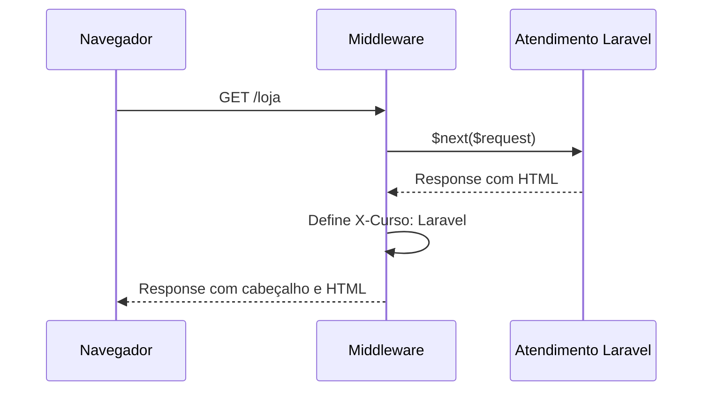

# Aula 4.14 — Primeiro middleware da loja

## Objetivo

Apresentar middleware como parte do caminho da requisição e da resposta.
MarcarRespostaCurso acrescenta o cabeçalho X-Curso: Laravel à resposta de /loja,
preservando seu HTML. Ele é associado somente a essa rota.

O conjunto de dois arquivos é inseparável: a classe fornece o middleware e
routes/web.php associa seu uso à rota. Controller e view foram preservados.

## Geração da classe

Conferimos que a pasta app/Http/Middleware estava ausente e consultamos
help make:middleware. O Artisan gerou a classe no Docker:

```bash
docker compose run --rm \
  --volume ./backend/app/Http:/app/app/Http:rw \
  backend php artisan make:middleware MarcarRespostaCurso --no-interaction
```

make:middleware recebe o nome da classe e cria o arquivo na pasta convencional.
A montagem temporária de app/Http permite criar a pasta Middleware, antes ausente.
O serviço normal continua com código somente leitura.

No mesmo container, após sucesso, chown --reference de /app/app/Http alinhou
o proprietário apenas da pasta Middleware e do arquivo novos. stat no host
confirmou 1000:1000. Geração e ajuste terminaram com código 0.

## MarcarRespostaCurso.php

O gerador preparou namespace App\Http\Middleware, imports e handle, que
inicialmente apenas retornava $next($request). Mantivemos essa estrutura e
alteramos o corpo para:

```php
public function handle(Request $request, Closure $next): Response
{
    $resposta = $next($request);
    $resposta->headers->set('X-Curso', 'Laravel');

    return $resposta;
}
```

Os imports gerados fornecem os tipos usados:

| Tipo | Origem e função |
| --- | --- |
| Request | Illuminate\Http\Request: objeto da requisição recebida. |
| Closure | Classe do PHP para função anônima; $next é a função de continuação fornecida pelo Laravel. |
| Response | Symfony\Component\HttpFoundation\Response: tipo do objeto de resposta devolvido. |

Essas classes já estavam disponíveis no PHP e nas dependências instaladas.
O comentário @param documenta a assinatura de entrada/saída de $next para
ferramentas de edição. handle é o método público chamado pelo Laravel nessa etapa
do processamento; a classe não precisa herdar de um controller.

$next($request) continua o atendimento pela cadeia do Laravel. O controller
produz a view e o framework gera a resposta. Quando a chamada retorna, $resposta
contém esse objeto Response.

headers é o objeto que administra os cabeçalhos da resposta. set recebe nome
e valor; nesta aula acrescenta X-Curso com valor Laravel. O return devolve a
resposta com seu corpo HTML preservado e o novo cabeçalho.

Representação simplificada do fluxo:



Um cabeçalho é informação da resposta HTTP. Ele fica fora do corpo HTML, portanto
a página visualmente continua com a mesma saudação e produtos.

## Associação à rota

routes/web.php recebeu o import e a associação:

```php
use App\Http\Middleware\MarcarRespostaCurso;

Route::get('/loja', [LojaController::class, 'index'])
    ->middleware(MarcarRespostaCurso::class);
```

Route::get devolve o objeto da rota, sobre o qual ->middleware registra a classe
a utilizar. ::class fornece seu nome completo, como na associação do controller.
Laravel executa o middleware quando essa rota é atendida. GET|HEAD permanece
registrado conforme o comportamento já apresentado nas aulas de rotas.

A rota / não recebeu essa associação. Não alteramos os middlewares globais,
aliases ou bootstrap/app.php; esses usos poderão ser aprofundados quando necessários.

## Verificações

```bash
docker compose exec -T backend php -l /app/app/Http/Middleware/MarcarRespostaCurso.php
docker compose exec -T backend php -l /app/routes/web.php
docker compose exec -T backend php artisan route:list --path=loja --except-vendor -v
```

As duas sintaxes passaram. -v detalha a listagem, mostrando o grupo web existente
e App\Http\Middleware\MarcarRespostaCurso associado a /loja.

Um diagnóstico HTTP em PHP no Docker verificou:

| Requisição | Resultado |
| --- | --- |
| GET /loja | HTTP 200, X-Curso: Laravel, título, saudação e três produtos preservados. |
| GET / | HTTP 200, título preservado e X-Curso ausente. |

O teste leu apenas o cabeçalho pretendido e comparou os trechos do HTML, sem
exibir cookies ou respostas completas. Isso verifica atuação e escopo do middleware.
Não foram necessários rebuild, reinício, dependências, banco, migrations, frontend
ou testes Laravel; chave, dados demonstrativos e laboratório preservados.

## Situação e próximo passo

Implementação e verificações concluídas; explicação apresentada e entendimento
confirmado com "entendi" em 13/10/2026. Checkpoint preparado para publicação.
Último checkpoint publicado: b944f4e, etapa 4.13.

Após confirmação, publicar 4.14 e iniciar 4.15: extrair os nomes demonstrativos
para App\Services\CatalogoDemonstracao, método listarNomes(): array, e recebê-lo
como parâmetro de index no controller. Apresentar injeção pelo container Laravel,
preservando a página e o middleware, com dados ainda em memória.

Fonte: [Middleware, resposta e associação às rotas](https://laravel.com/docs/13.x/middleware).
