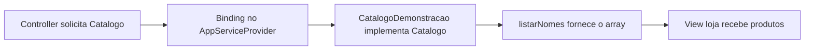

# Aula 4.17 — Contrato e binding do catálogo

## Objetivo

Receber uma interface de catálogo no controller e registrar qual implementação
o container deve entregar. Aplicamos interfaces estudadas no módulo 3 à injeção
Laravel, apresentando o binding e a função de um service provider.

O conjunto de quatro arquivos é inseparável: contrato, implementação, consumidor
e registro da ligação precisam corresponder. Dados e apresentação foram preservados.

## Catalogo.php: contrato

O arquivo estava ausente e foi criado em app/Contracts:

```php
<?php

namespace App\Contracts;

interface Catalogo
{
    public function listarNomes(): array;
}
```

O namespace coloca o contrato em App\Contracts. A interface exige um método
público listarNomes com retorno array. A declaração termina em ponto e vírgula;
o corpo do método será fornecido pela implementação.

A pasta Contracts organiza nossas interfaces; o autoload App\\ -> app/ já
existente encontra esse arquivo. Uma interface descreve operações disponíveis;
o objeto entregue ao controller será de uma classe que a implementa.

## CatalogoDemonstracao.php: implementação

A classe recebeu o import e implements:

```php
use App\Contracts\Catalogo;

class CatalogoDemonstracao implements Catalogo
```

listarNomes(): array já satisfazia a assinatura exigida. Seu corpo continua
retornando Camiseta, Calça e Tênis, na mesma ordem. Um objeto dessa classe também
atende ao tipo Catalogo.

## LojaController.php: consumidor

O import passou a ser App\Contracts\Catalogo, e o construtor ficou assim:

```php
public function __construct(private Catalogo $catalogo)
{
}
```

A propriedade promovida e o uso de $this->catalogo->listarNomes() permanecem.
O controller declara as operações necessárias pelo contrato; o provider define
qual classe o Laravel usará para fornecê-las.

O container precisa dessa indicação porque uma interface não possui a construção
de um objeto concreto. O registro permite resolver o contrato solicitado.

## AppServiceProvider.php: ligação

O provider existente recebeu imports de Catalogo e CatalogoDemonstracao. Seu
método register passou a conter:

```php
public function register(): void
{
    $this->app->bind(Catalogo::class, CatalogoDemonstracao::class);
}
```

AppServiceProvider estende Illuminate\Support\ServiceProvider. A propriedade
$this->app, fornecida pela classe base, dá acesso à aplicação e ao container.

bind registra uma regra: quando Catalogo for solicitado, resolver
CatalogoDemonstracao. Os argumentos ::class fornecem os nomes completos dos
tipos. Registrar essa regra permite ao container escolher a implementação
quando uma dependência do contrato for solicitada.

Service providers organizam registros e preparação da aplicação. register é o
ponto usado para bindings. O método boot existente permaneceu vazio; ele é usado
para preparação após o registro dos providers quando houver necessidade.

bootstrap/providers.php já lista AppServiceProvider::class. Durante a
inicialização, Laravel carrega esse provider e chama register. Não foi preciso
adicionar outro provider ou fazer chamadas manuais na rota.

## Relação entre os arquivos



Assim, o controller utiliza o contrato e o registro seleciona a implementação.
Essa ligação pode ser alterada quando outra implementação for introduzida, mantendo
o uso das operações do contrato. Nesta aula há apenas a classe demonstrativa.

## Verificações

php -l no Docker passou para Catalogo.php, CatalogoDemonstracao.php,
LojaController.php e AppServiceProvider.php.

Um diagnóstico temporário no Docker inicializou o kernel de console Laravel e
solicitou o contrato pelo container:

```php
$catalogo = $app->make(App\Contracts\Catalogo::class);
```

make resolve o tipo solicitado usando os registros disponíveis. O diagnóstico
conferiu que o binding estava registrado, que o objeto era CatalogoDemonstracao
e também atendia à interface Catalogo, e que os três nomes estavam preservados.

O diagnóstico HTTP no container backend verificou:

- GET /loja HTTP 200, com título, saudação, nomes na ordem e X-Curso: Laravel.
- GET / HTTP 200, welcome preservada e sem X-Curso.
- Rota, view, middleware, bootstrap/providers.php, src, Compose, imagem, JSON,
  lockfile e ambiente preservados. Sem rebuild, reinício ou dump-autoload.
- Sem banco, migrations, testes Laravel, frontend, dependências ou contador.

A resolução confirma o registro e o contrato; o HTTP confirma a ligação funcionando
no controller real. Os testes não imprimiram cookies ou respostas completas.

## Situação e próximo passo

Implementação e verificações concluídas; explicação apresentada e entendimento
confirmado com "entendi" em 13/10/2026. Checkpoint 92d6e5f publicado;
HEAD, origin/main e consulta direta à main remota coincidiram.

Após confirmação, publicar 4.17 e iniciar 4.18: apresentar o M de MVC pelo arquivo
app/Models/User.php já gerado, explicar seu papel como model Eloquent e demonstrar
uma instância e seus atributos em memória, sem consulta, save ou migration.
Persistência SQL Server continua no módulo 5; autenticação, factories e seus usos
serão aprofundados nas etapas previstas.

Fontes oficiais:

- [Ligação de interfaces a implementações](https://laravel.com/docs/13.x/container#binding-interfaces-to-implementations).
- [Método register dos providers](https://laravel.com/docs/13.x/providers#the-register-method).
