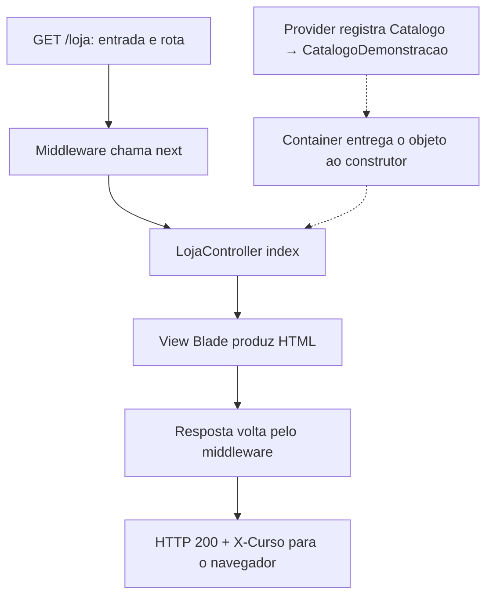

# Aula 4.19 — Revisão do módulo 4

## Objetivo

Relacionar as peças estudadas no módulo Laravel e MVC, conferir a entrega e
registrar pendências para SQL Server. Esta é uma revisão, sem código novo.
O módulo será encerrado após confirmação explícita de entendimento desta etapa.

## Entrega atual

- Laravel 13.35.0 com PHP 8.4.26 e Composer 2.10.3 no Docker.
- Backend independente em backend/, com composer.json e lockfile próprios.
- / responde com welcome e /loja apresenta saudação e três nomes demonstrativos.
- Blade recebe dados, faz escape e usa @foreach e @if/@else.
- Middleware acrescenta X-Curso: Laravel somente à resposta da rota /loja.
- Controller recebe Catalogo por injeção no construtor; provider liga o contrato
  a CatalogoDemonstracao. Dados permanecem em memória.
- User existente apresentado como model Eloquent com atributos em memória.
- Laboratório src preservado, com Composer e vendor independentes.

## Caminho da requisição

O navegador acessa http://127.0.0.1:8002/loja. Docker encaminha a porta 8002 do
computador para 8000 no container backend, onde Artisan serve está ativo.

public/index.php carrega vendor/autoload.php, obtém a aplicação de bootstrap/app.php
e entrega o Request ao Laravel. A inicialização carrega ambiente, configuração
e providers; AppServiceProvider registra o binding Catalogo -> CatalogoDemonstracao.

O roteador encontra GET /loja em routes/web.php. A rota indica LojaController@index
e o middleware MarcarRespostaCurso. O container resolve a dependência tipada e
entrega o catálogo ao construtor do controller.

O middleware chama $next($request) para continuar o atendimento. index consulta
listarNomes e retorna a view loja com nomeLoja e produtos. Blade produz HTML;
a resposta volta pelo middleware, que acrescenta o cabeçalho antes da saída.

Fluxo simplificado, mostrando o atendimento e a dependência:



O diagrama resume responsabilidades; a dependência é resolvida na construção
do controller e está guardada na propriedade quando index a utiliza.

## Arquivos e responsabilidades

| Arquivo ou grupo | Papel estudado |
| --- | --- |
| artisan | Entrada dos comandos de console: versão, ajuda, geradores e chave. |
| public/index.php e bootstrap/app.php | Entrada HTTP e configuração inicial da aplicação. |
| routes/web.php | Método, caminho e destino do atendimento. |
| LojaController.php | Recebe catálogo, organiza dados e escolhe a view. |
| Contracts/Catalogo.php | Declara listarNomes(): array. |
| Services/CatalogoDemonstracao.php | Implementa o contrato com três nomes em memória. |
| AppServiceProvider.php e bootstrap/providers.php | Registra a ligação e permite seu carregamento na inicialização. |
| MarcarRespostaCurso.php | Continua o atendimento e altera cabeçalho da resposta. |
| resources/views/loja.blade.php | HTML, dados escapados, laço e condição de lista vazia. |
| Models/User.php | Model Eloquent já gerado, apresentado sem persistência. |
| composer.json, composer.lock e vendor | Configuração, versões exatas e pacotes/autoload instalados. |
| .env.example e .env | Modelo versionado e ambiente local ignorado, incluindo chave. |
| storage e bootstrap/cache | Arquivos gerados, com montagens graváveis e exclusões do Git. |

Model, controller e view têm papéis distintos: dados/comportamento, atendimento
e apresentação. A página demonstrativa ainda usa CatalogoDemonstracao; User foi
estudado separadamente. O catálogo persistido será construído no módulo 5.

## Comandos que já sabemos usar

```bash
docker compose up -d backend
docker compose ps
docker compose logs --tail 10 backend
docker compose stop backend
docker compose run --rm backend php artisan --version
docker compose exec -T backend php artisan route:list --path=loja --except-vendor -v
```

up aplica/inicia a configuração; -d mantém o serviço em segundo plano. ps informa
estado e portas; logs acompanha saídas; stop interrompe o serviço. run cria um
container temporário para um comando explícito; exec utiliza o container ativo.
As verificações deste fechamento usaram ps, route:list e diagnóstico HTTP.
Não repetimos build, instalação ou parada/reinício, já verificados nas etapas próprias.

## Verificação da entrega

Um diagnóstico PHP em Docker, com rede do host, consultou as portas publicadas:

| URL | Resultado |
| --- | --- |
| 127.0.0.1:8002/loja | HTTP 200, título e saudação corretos, Camiseta/Calça/Tênis na ordem e X-Curso: Laravel. |
| 127.0.0.1:8002/ | HTTP 200, sem X-Curso. |
| 127.0.0.1:8001/ | HTTP 200, laboratório preservado. |

route:list confirmou LojaController@index, grupo web e MarcarRespostaCurso.
Os dois serviços estavam ativos. Código, Dockerfile e Compose permaneceram iguais;
backend/.env continua ignorado. Cookies e respostas completas não foram impressos.

As verificações anteriores de renderização já cobriram escape e lista vazia;
esta revisão conferiu a entrega HTTP atual. A experiência de User ficou em memória,
sem representar consulta ou gravação no banco.

## Pendências para persistência

- sqlsrv e pdo_sqlsrv não estão carregados no PHP atual, conforme diagnóstico
  somente de leitura nesta revisão. ODBC e drivers serão introduzidos na etapa necessária.
- SQL Server ainda não foi criado/configurado; nenhum banco ou migration executado.
- PHP/configuração, imagem SQL Server e recursos Docker precisam ter compatibilidade
  conferida antes de instalação, com versões identificáveis.
- Configurar o catálogo persistido e um banco SQL Server exclusivo para integração.
- Ajustar os padrões SQLite ainda presentes em config/database.php e phpunit.xml
  antes de usar persistência/testes, preservando a escolha SQL Server do curso.
- Preparar credenciais somente em configuração local ignorada. Não versionar
  .env, chave, sessões, logs ou credenciais.

Nesta etapa não iniciamos banco, instalamos dependências ou executamos o contador.
A revisão fecha a aprendizagem do módulo; persistência terá sua preparação própria.

## Situação e próximo passo

Revisão apresentada e entrega HTTP conferida; entendimento confirmado com "entendi"
em 13/10/2026. Módulo 4 concluído. Sem implementação nova; checkpoint 2346772
publicado conforme autorização existente. HEAD, origin/main e consulta direta
à main remota retornaram `23467729d7d3d5ebf6587084cab007ad1afa4df7`.

Depois da publicação, iniciar 5.1: diagnóstico de preparação
SQL Server, conferindo arquitetura/recursos Docker, plataforma PHP e requisitos
oficiais de compatibilidade. Nenhum banco deve ser criado antes de sua etapa.

Fonte: [Ciclo da requisição Laravel](https://laravel.com/docs/13.x/lifecycle).
