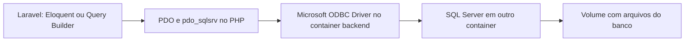

# Aula 5.1 — Preparação para SQL Server

## Objetivo

Conferir o ambiente antes de instalar os componentes de persistência.
O módulo 4 foi concluído após o aluno confirmar a revisão 4.19 com "entendi".
Seu checkpoint foi publicado e verificado:
`23467729d7d3d5ebf6587084cab007ad1afa4df7`.

Hoje, CatalogoDemonstracao entrega um array escrito no código. Alterar um
objeto PHP só muda seus dados durante aquela execução. Com persistência,
uma operação de gravação pode guardar um produto no banco para outras requisições.
Criar uma instância de Model, por si só, não faz essa gravação.

## Caminho da conexão



Esse é o caminho que construiremos; a conexão ainda não está implementada.
PDO é a interface de acesso a bancos do PHP. pdo_sqlsrv é sua extensão para
SQL Server. O driver ODBC é uma biblioteca usada por essa extensão para se
comunicar com o servidor. Ambos ficam no ambiente em que o PHP executa.
sqlsrv também é uma extensão Microsoft, com funções próprias; a documentação
Laravel orienta instalar sqlsrv e pdo_sqlsrv, além das dependências ODBC.

O SQL Server será um serviço separado no Compose. Seus arquivos precisarão
de volume persistente, como estudamos no Docker. A configuração Laravel
indicará o nome desse serviço na rede: dentro do backend, localhost aponta
para o próprio backend. Definiremos nomes, volume e credenciais na aula de banco.

## Comandos e resultados

Os comandos de controle Docker foram executados no host; PHP executou no
container backend ativo. Os diagnósticos apenas leram o ambiente.

```bash
docker info --format 'Sistema={{.OSType}} Arquitetura={{.Architecture}} CPUs={{.NCPU}} MemoriaBytes={{.MemTotal}} Armazenamento={{.Driver}} Diretorio={{.DockerRootDir}}'
docker compose ps
docker compose exec -T backend cat /etc/os-release
docker compose exec -T backend uname -m
docker compose exec -T backend df -h -T / /app
df -h -T /var/lib/docker
```

info consulta o daemon; --format seleciona campos sem imprimir toda sua
configuração. ps mostra serviços ativos. exec -T executa no serviço existente
sem terminal interativo. os-release identifica a distribuição; uname -m
identifica arquitetura; df informa sistema de arquivos e espaço.
Também lemos MemTotal/MemAvailable em /proc/meminfo e o clock em /proc/cpuinfo.

```bash
docker compose exec -T backend php -r 'echo PHP_VERSION, PHP_EOL; foreach (["PDO", "sqlsrv", "pdo_sqlsrv"] as $ext) { echo $ext, "=", extension_loaded($ext) ? "carregada" : "ausente", PHP_EOL; } echo "DriversPDO=", implode(",", PDO::getAvailableDrivers()), PHP_EOL;'
```

php -r executa o trecho recebido como argumento. extension_loaded verifica
extensões carregadas. PDO::getAvailableDrivers lista os drivers utilizáveis
pela interface PDO; não conecta nem consulta banco.

| Diagnóstico em 13/10/2026 | Resultado |
| --- | --- |
| Docker | Linux x86_64, 8 CPUs, 8.193.597.440 bytes de RAM: cerca de 7,63 GiB. |
| Memória disponível no momento | 5.332.836 KiB, cerca de 5,09 GiB; pode variar. |
| Clock observado | Até 2419,2 MHz na leitura; não é teste de desempenho. |
| Armazenamento Docker | /var/lib/docker sobre ext4, cerca de 942 GiB livres. |
| Driver de armazenamento | Docker informa overlayfs; raiz do container overlay, dados no host ext4. |
| Backend | Debian 12 bookworm, x86_64; PHP 8.4.26, 64 bits, sem thread safety. |
| Extensões | PDO carregada; sqlsrv e pdo_sqlsrv ausentes; PDO lista apenas sqlite. |
| Pacotes ODBC consultados | msodbcsql18, unixodbc e libodbc2 não encontrados por dpkg-query. |
| Serviços | php e backend ativos, portas locais 8001 e 8002. |

## Compatibilidade e decisões

A Microsoft informa requisitos Linux de 2 GB de memória mínima, 6 GB de disco,
dois núcleos, 2 GHz e processador x64. Containers SQL Server são suportados
em hosts Linux Intel/AMD x86-64. Os recursos observados atendem ao diagnóstico
inicial para este laboratório; disponibilidade muda conforme outros processos.
A inicialização e a conexão reais ainda serão verificadas nas respectivas aulas.

Usaremos SQL Server 2022 Developer como base do laboratório. Developer é
destinada a desenvolvimento e testes; a escolha de produção será tratada no deploy.
A tag específica de atualização e seu digest serão conferidos e fixados quando
a imagem for introduzida. Nenhuma imagem SQL Server foi baixada nesta aula.

A matriz Microsoft certifica a linha 5.13 para PHP 8.4, Debian 12 e SQL Server
2022. A versão 5.13.3 é a versão estável indicada nas releases consultadas.
ODBC Driver 18 é compatível com essa linha. As versões exatas dos pacotes
e o método de instalação serão conferidos novamente ao modificar a imagem.

## Arquivos e próximo passo

Criado apenas este material de aula e atualizados README, roteiro, progresso
e situação da revisão anterior. Dockerfile, Compose e aplicação preservados.
Nenhuma instalação, credencial nova, criação de banco ou migration executada.
Os testes Laravel ainda terão um banco SQL Server exclusivo; os padrões SQLite
do esqueleto serão ajustados antes de usar persistência ou testes de integração.

Explicação e diagnóstico apresentados; entendimento da 5.1 confirmado com "entendi"
em 13/10/2026. Checkpoint 41d0660 publicado conforme autorização existente.
HEAD, origin/main e consulta direta à main remota retornaram
`41d0660945bd3b91dc3a036017986e1adc6c2ff5`.
Depois da confirmação: publicar 5.1 e iniciar 5.2, preparar uma imagem própria
do backend com Microsoft ODBC Driver 18, mantendo a imagem do laboratório PHP.
Extensões PHP e serviço SQL Server terão suas etapas seguintes.

Fontes consultadas em 13/10/2026:

- [Configuração SQL Server no Laravel](https://laravel.com/docs/13.x/database#sql-server-configuration).
- [Requisitos SQL Server no Linux](https://learn.microsoft.com/en-us/sql/linux/install-upgrade/setup?view=sql-server-ver16#system-requirements).
- [Edições SQL Server 2022](https://learn.microsoft.com/en-us/sql/sql-server/editions-and-components-of-sql-server-2022?view=sql-server-ver16).
- [Matriz dos drivers PHP](https://learn.microsoft.com/en-us/sql/connect/php/microsoft-php-drivers-for-sql-server-support-matrix?view=sql-server-ver17).
- [Requisitos ODBC dos drivers PHP](https://learn.microsoft.com/en-us/sql/connect/php/system-requirements-for-the-php-sql-driver?view=sql-server-ver17#odbc-driver).
- [Release dos drivers 5.13.3](https://github.com/microsoft/msphpsql/releases/tag/v5.13.3).
- [Instalação ODBC no Debian](https://learn.microsoft.com/en-us/sql/connect/odbc/linux-mac/installing-the-microsoft-odbc-driver-for-sql-server?view=sql-server-ver17#debian).
