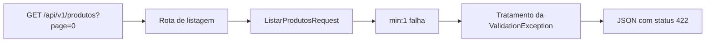

# Aula 6.80 — Revisão guiada de uma requisição inválida

Revisão, explicação e verificação em 01/11/2026 após confirmação da 6.79 com
"entendi" e publicação em cbe8ae9e8250b4903767f4dc6ef5b7c9cb9b765c.
Entendimento da 6.80 confirmado com "entendi" em 01/11/2026; publicação
verificada em 93f05de79be9cb298e965bfb7aa11cb317960903, referências local e remotas coincidentes.

## Objetivo

Acompanhar GET /api/v1/produtos?page=0 pelos arquivos já existentes, até a
resposta 422, o teste e o contrato. Acrescentamos esta aula e os registros de
acompanhamento; código executável e README permanecem como estavam.



## Da URL às regras de entrada

[Bootstrap](../../backend/bootstrap/app.php) registra routes/api.php com
apiPrefix api/v1. Em [api.php](../../backend/routes/api.php), a rota GET
/produtos aponta para ProdutoController@index. Page=0 pertence à query string;
a rota selecionada continua sendo a de listagem.

[Index](../../backend/app/Http/Controllers/Api/V1/ProdutoController.php) recebe
ListarProdutosRequest como argumento. O Laravel resolve e valida esse FormRequest
antes de chamar o método, conforme a
[documentação oficial](https://laravel.com/docs/13.x/validation#form-request-validation).
Neste projeto, authorize() retorna true; as regras estão em
[ListarProdutosRequest](../../backend/app/Http/Requests/ListarProdutosRequest.php):

```php
'page' => [
    'bail',
    'sometimes',
    'required',
    'integer',
    'min:1',
    'max:1000000',
    'regex:/\A[1-9][0-9]*\z/',
],
```

Page está presente; sometimes permite omitir o campo, mas não pula sua validação
quando ele foi enviado. O texto '0' da query atende required e integer, porém
seu valor fica abaixo de 1. Min:1 falha. Bail interrompe as regras seguintes
para esse campo, conforme a
[regra bail](https://laravel.com/docs/13.x/validation#rule-bail); max e regex
não são avaliados para page nesta entrada. Isso não significa interromper a
validação de todos os outros campos. Nome foi omitido e é opcional.

## O ponto onde o caminho muda

A falha produz uma ValidationException antes da execução do corpo de index.
Por isso, a linha de index que chama paginarProdutos não é alcançada neste
caminho; a coleção de ProdutoResource da resposta 200 também não é produzida.
Essa conclusão vem da combinação do fluxo de FormRequest documentado com a
leitura do código local; o teste focado abaixo observa a resposta final.

O método pagina() contém:

```php
return (int) $this->validated('page', 1);
```

O padrão 1 serve para page ausente após validação bem-sucedida. Ele não corrige
page=0: neste caso a validação já falhou, e index não chama pagina().
É como conferir uma entrada antes de executar a rotina de consulta em PHP.

No [tratamento de exceções](../../backend/bootstrap/app.php), shouldRenderJsonWhen
seleciona JSON para caminhos api/* ou requisições que esperam JSON. A exceção
é transformada pelo Laravel em status 422 com message/errors, conforme o
[formato de erros de validação](https://laravel.com/docs/13.x/validation#validation-error-response-format).
A resposta vem desse tratamento; a assinatura de retorno de index não precisa
ser executada para gerar esse erro.

## O que o teste observa

Em [CatalogoApiTest](../../backend/tests/Feature/CatalogoApiTest.php), a entrada
zero de paginasInvalidas fornece page=0 ao teste:

```php
$resposta = $this->getJson('/api/v1/produtos?'.$query);

$resposta
    ->assertStatus(422)
    ->assertHeader('Content-Type', 'application/json')
    ->assertJsonStructure(['message'])
    ->assertJsonValidationErrors(['page']);
```

GetJson faz a requisição interna do teste Laravel. As asserções exigem status,
Content-Type, message presente e erros para page; não fixam a frase traduzida.
Com CAPTURAR_CONTRATO_LISTAGEM_422=1 e query exatamente page=0, o bloco posterior
grava o corpo bruto no arquivo privado listagem-422.json, conferindo JSON/bytes.

A preparação setUp do teste consulta a identidade SQL e limpa produtos dentro
da transação. Portanto, esta revisão não afirma que a execução inteira do teste
faz zero SQL. O ponto do fluxo é que o corpo de index não alcança a chamada ao
catálogo quando o FormRequest falha. Não acrescentamos instrumentação de chamadas.

## Da captura ao schema

[OpenAPI](../api/openapi.json) descreve a resposta 422 de GET /api/v1/produtos:
objeto com message texto e errors objeto com ao menos um campo; cada campo de
errors contém uma lista não vazia de textos. O schema admite erros de page ou
nome sem fixar o texto traduzido. Seu example permanente é ilustrativo.

O [script comum](../../scripts/validar-contrato-produto.sh) escolhe o teste@zero,
ativa a captura e coloca o corpo observado como example somente numa cópia
temporária do OpenAPI. Redocly compara essa cópia ao schema correspondente.
A regra executada para rejeitar a entrada está no FormRequest; o schema é usado
na descrição e na comparação do contrato, fora do atendimento normal da rota.

## Verificação desta revisão

Executamos:

```sh
bash scripts/validar-contrato-produto.sh 422 listagem
```

PHP/teste e Redocly rodaram em Docker pelo fluxo já estudado. Resultado:
1 teste/9 asserções; lint e processo 0. Captura renovada e lida via PHP Docker:

```json
{
  "message": "The page field must be at least 1.",
  "errors": {
    "page": ["The page field must be at least 1."]
  }
}
```

105 bytes, SHA256
8dab8e21482477f6b0a6b77d2241166d86848d7322f250fb51665982d8bde6d1.
Frase observada, sem alterar a expectativa do teste ou o schema. Temporários
removidos; captura ignorada. SELECTs após: loja/loja_app 0 categorias/1 produto;
loja_test/loja_testes 0 categorias/0 produtos. Diff e links conferidos. Backend,
scripts, OpenAPI/configuração, Compose, README e dependências intactos. Sem nova
suíte completa; última 6.76, 66 testes/620 asserções. Limite do validador da 6.64
permanece registrado; aprovação deste caso não prova todas as respostas possíveis.

## Continuidade

Aula anterior registra publicação da 6.79; catálogo, roteiro e progresso
registram esta revisão, explicação e verificação. Entendimento confirmado com
"entendi" em 01/11/2026; publicação verificada. Depois de publicar, iniciar
somente 6.81: revisar GET /api/v1/produtos?page=1, do controller à paginação e
serialização data/links/meta. Módulo 6 continua em andamento; DBeaver sem relato.

Continuidade realizada na [aula 06-81](06-81-revisao-listagem-valida.md):
revisão de entrada válida, controller, paginação e Resources.
