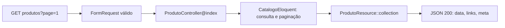

# Aula 6.81 — Revisão guiada da listagem válida

Revisão, explicação e verificação em 01/11/2026 após confirmação da 6.80 com
"entendi" e publicação em 93f05de79be9cb298e965bfb7aa11cb317960903.
Entendimento da 6.81 confirmado com "entendi" em 01/11/2026; publicação
verificada em 37b194d36e03209c5e27d7378dc3f07fdcee8783, referências local e remotas coincidentes.

## Objetivo e caminho

Acompanhar GET /api/v1/produtos?page=1 pelos arquivos existentes, do controller
até paginação e serialização. Acrescentamos esta aula e os registros de
acompanhamento; código executável e README permanecem como estavam.



## Entrada validada e controller

[ListarProdutosRequest](../../backend/app/Http/Requests/ListarProdutosRequest.php)
aceita page=1: campo presente, inteiro, mínimo 1, máximo 1000000 e formato decimal
canônico. Pagina() devolve o inteiro 1. Sem nome, nome() devolve null. A rota GET
/produtos, sob o prefixo api/v1, chega a
[ProdutoController@index](../../backend/app/Http/Controllers/Api/V1/ProdutoController.php):

```php
$paginacao = $catalogo->paginarProdutos($request->pagina(), $request->nome());
$paginacao->appends($request->safe()->only(['nome']));

return ProdutoResource::collection($paginacao);
```

O controller coordena as chamadas. O argumento Catalogo é a
[interface](../../backend/app/Contracts/Catalogo.php), ligada a CatalogoEloquent
pelo [AppServiceProvider](../../backend/app/Providers/AppServiceProvider.php).
O container entrega a implementação conforme esse vínculo.

Nesta entrada, paginarProdutos recebe 1 e null. Appends preserva somente nome
validado nos links; como nome não foi enviado, não há esse filtro para acrescentar.
O controller entrega o paginador à coleção de recursos.

## Consulta e paginação

Em [CatalogoEloquent](../../backend/app/Services/CatalogoEloquent.php), a consulta
começa com where('status', 'ativo'). O bloco opcional CHARINDEX só participa
quando nome não é null. O trecho final é:

```php
return $consulta
    ->orderBy('nome')
    ->orderBy('id')
    ->paginate(10, ['id', 'nome', 'preco_em_centavos'], 'page', $pagina);
```

A ordem por nome e depois id resolve empates. Os argumentos de paginate definem
10 itens por página, as três colunas selecionadas, o nome page do parâmetro e
a página validada recebida. O paginador guarda os produtos e informações como
total/per_page/current_page/last_page. A
[documentação de paginação](https://laravel.com/docs/13.x/pagination#basic-usage)
explica a contagem dos resultados e o recorte da página. Não instrumentamos SQL
nesta revisão; relacionamos o código local ao fluxo documentado.

## ProdutoResource e o envelope paginado

[ProdutoResource](../../backend/app/Http/Resources/ProdutoResource.php) define
a apresentação de cada produto em toArray:

```php
return [
    'id' => $this->id,
    'nome' => $this->nome,
    'preco_em_centavos' => $this->preco_em_centavos,
];
```

Esses três campos formam cada item de data. A chamada collection recebe o
paginador; a infraestrutura de Resources do Laravel combina os itens com
links e meta da paginação. Essa relação é descrita na
[documentação de Resources paginados](https://laravel.com/docs/13.x/eloquent-resources#pagination).

| Campo do corpo | Papel |
| --- | --- |
| data | Lista dos produtos da página, apresentados por ProdutoResource |
| links | URLs first/last/prev/next para navegação |
| meta | Estado da paginação, incluindo total, per_page e opções meta.links |

Se a página tem só um produto, data continua sendo uma lista. Per_page=10 é o
limite configurado; não exige dez produtos na resposta. Total descreve os
produtos que correspondem à consulta, enquanto count(data) descreve essa página.

## Verificações desta revisão

Fizemos duas verificações distintas em Docker:

1. HTTP real com page=1 explícito, via diagnóstico temporário
   /tmp/curso-681-http-page1.php. PHP CLI fez GET no servidor do próprio container
   em http://127.0.0.1:8000/api/v1/produtos?page=1, com Accept application/json.
   Resposta 200/application/json; data/links/meta, 1 item, current_page 1,
   per_page 10, total 1, last_page 1, prev/next null. Usa o catálogo normal por HTTP.
   No host, a publicação do backend continua na porta 8002; a porta 8000 é interna.
2. Comando de contrato já existente:

```sh
bash scripts/validar-contrato-produto.sh 200 listagem
```

O segundo usa test_retorna_produto_ativo_em_json, factory da Camiseta e banco
loja_test. Esse teste faz GET sem page e exercita o padrão 1; não foi alterado
para enviar page=1. Passou com 1 teste/14 asserções e lint/processo 0. Asserções
conferem produto/links/paginação e o script compara a captura ao schema 200
[OpenAPI](../api/openapi.json), com data/links/meta obrigatórios e Produto por ref.

Captura atual do teste: 586 bytes, ID observado 23044, Camiseta/preço inteiro 4990,
current_page 1/per_page 10/total 1 e três opções meta.links. ID vem da factory;
não é expectativa fixa. SHA256
1d1bf2e10663de57d8bf51ce80a41ff699b33b683b138e8571a589b0d4387e1b.
Captura ignorada, temporários removidos; diff/links conferidos. SELECTs após:
loja/loja_app 0 categorias/1 produto; loja_test/loja_testes 0 categorias/0 produtos.
Backend/scripts/OpenAPI/configuração/Compose/README/dependências intactos.
Sem nova suíte completa; última 6.76, 66 testes/620 asserções. Limite do validador
da 6.64 registrado; as verificações acima não provam todas as respostas possíveis.

## Continuidade

Aula anterior registra publicação da 6.80; catálogo/roteiro/progresso atualizados.
Entendimento confirmado com "entendi" em 01/11/2026; publicação verificada.
Depois de publicar, iniciar somente 6.82: revisão guiada da consulta individual por ID,
ligando produto ativo e resposta 404. Módulo 6 em andamento; DBeaver sem relato.

Continuidade realizada na [aula 06-82](06-82-revisao-consulta-individual.md):
revisão da consulta por ID, Produto/null e respostas 200/404.
