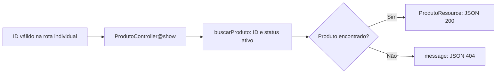

# Aula 6.82 — Revisão da consulta individual por ID

Revisão, explicação e verificação em 01/11/2026 após confirmação da 6.81 com
"entendi" e publicação em 37b194d36e03209c5e27d7378dc3f07fdcee8783.
Entendimento da 6.82 confirmado com "entendi" em 01/11/2026; publicação em preparação.

## Objetivo e caminho principal

Acompanhar GET /api/v1/produtos/{id}, relacionando produto ativo, retorno
nullable e respostas 200/404. Acrescentamos esta aula e os registros; aplicação,
scripts e contratos permanecem como estavam.



## Rota e validação do identificador

Em [api.php](../../backend/routes/api.php), a rota /produtos/{id} aponta para
show e exige o padrão [1-9][0-9]*. Com o prefixo api/v1 registrado no bootstrap,
a URL pública fica /api/v1/produtos/{id}. Id é parte do caminho; page e nome
pertencem à operação de listagem.

No [controller](../../backend/app/Http/Controllers/Api/V1/ProdutoController.php),
show recebe Catalogo e string $id. A interface é ligada a CatalogoEloquent
pelo [AppServiceProvider](../../backend/app/Providers/AppServiceProvider.php).
O primeiro trecho é:

```php
$idValidado = filter_var($id, FILTER_VALIDATE_INT, [
    'options' => ['min_range' => 1],
]);

$produto = $idValidado === false
    ? null
    : $catalogo->buscarProduto($idValidado);
```

FILTER_VALIDATE_INT valida e converte para inteiro; min_range exige ao menos 1,
conforme os [filtros de validação do PHP](https://www.php.net/manual/en/filter.constants.validation.php).
Neste uso, a falha retorna false, conforme
[filter_var](https://www.php.net/manual/en/function.filter-var.php). A comparação
estrita === false decide se a busca será chamada. Uma sequência de dígitos pode
passar pelo formato da rota e ainda exceder a faixa do inteiro PHP; nesse caso,
o controller deixa produto como null sem chamar buscarProduto.

A consulta individual usa essa validação própria. O FormRequest da listagem
não é argumento de show e não determina o resultado desta operação.

## Busca e retorno nullable

Em [CatalogoEloquent](../../backend/app/Services/CatalogoEloquent.php):

```php
public function buscarProduto(int $id): ?Produto
{
    return Produto::query()
        ->where('status', 'ativo')
        ->whereKey($id)
        ->first(['id', 'nome', 'preco_em_centavos']);
}
```

WhereKey restringe a chave primária ao ID recebido. Where exige status ativo;
first retorna o produto correspondente ou null, selecionando os três campos
públicos. ?Produto expressa esse contrato de retorno: Produto ou null.

Um produto inativo não atende ao filtro, mesmo que exista no banco. A API
recebe null nessa busca. A operação é de leitura; o filtro não exclui o registro.
O teste de inativo abaixo confere sua permanência durante o cenário.

## Como show escolhe a resposta

```php
if ($produto === null) {
    return response()->json(['message' => 'Produto não encontrado.'], 404);
}

return new ProdutoResource($produto);
```

Null leva ao JSON 404 com message. Um Produto leva ao
[ProdutoResource](../../backend/app/Http/Resources/ProdutoResource.php), que
apresenta id/nome/preco_em_centavos. Na consulta individual, data é um objeto;
na listagem, data é uma lista acompanhada de links/meta. O retorno declarado
ProdutoResource|JsonResponse permite as duas formas usadas por show.

| Entrada/situação | Caminho e resultado |
| --- | --- |
| ID válido de produto ativo | Busca encontra Produto; Resource e 200 |
| ID válido inexistente ou de produto inativo | Busca retorna null; message e 404 |
| ID com letras, zero ou zeros iniciais | Rota não corresponde; 404 de roteamento |
| Dígitos positivos fora da faixa do inteiro PHP | Formato passa; filter_var falha; 404 do controller |

O [bootstrap](../../backend/bootstrap/app.php) determina JSON para caminhos
api/*. O texto de message do 404 de roteamento pode variar; o schema não fixa
uma frase para todos os 404. Os casos malformado/fora da faixa acima foram
revisados pelo código e pelos testes existentes, sem nova execução nesta etapa.

## Testes, capturas e contratos

Em [CatalogoApiTest](../../backend/tests/Feature/CatalogoApiTest.php), o cenário
ativo cria Caneca e Camiseta por factory e consulta o ID real da Camiseta.
O cenário inexistente consulta /produtos/1 depois da limpeza transacional do
setUp, com a tabela vazia. Esse 1 é o ID consultado ausente naquele teste; o
cenário ativo não fixa um ID gerado. O cenário inativo cria Caneca inativa,
exige 404 e usa assertDatabaseHas para conferir que ela continua no banco.
Depois do teste, DatabaseTransactions desfaz a fixture.

Reproduzimos em Docker:

```sh
bash scripts/validar-contrato-produto.sh 200 consulta
bash scripts/validar-contrato-produto.sh 404 consulta
docker compose exec -T backend php artisan test --do-not-cache-result \
  --filter=test_retorna_404_em_json_para_produto_inativo
```

Cada comando de contrato passou com 1 teste/7 asserções e lint/processo 0;
o teste de inativo passou com 1/7. O script comum escolhe teste/flag/arquivo e
schema da consulta individual, exige captura atual e valida example em cópia
temporária integral do [OpenAPI](../api/openapi.json). Schema 200 exige data
referenciando Produto; schema 404 exige message texto. A aprovação compara os
corpos desses casos aos schemas, complementando as asserções de comportamento.

Capturas conferidas via PHP Docker: 200 com data objeto/Camiseta/ID observado 23046/
preço inteiro 4990, 64 bytes, SHA256
728bbdf1947780fb022613ccd549435a6739c2d42bb1bdfca8231efd49d7fdf4;
404 com message Produto não encontrado., 42 bytes, SHA256
7d5b3a5bdfea032180e3ee337a2e028e7c492036c9acf6af05e9f6c965317c04.
IDs observados não são fixados como expectativa. Capturas ignoradas, temporários
removidos; diff/links conferidos. SELECTs após: loja/loja_app 0 categorias/1 produto;
loja_test/loja_testes 0 categorias/0 produtos. Backend/scripts/OpenAPI/configuração/
Compose/README/dependências intactos. Sem nova suíte completa; última 6.76, 66/620.
Limite do validador da 6.64 continua registrado.

## Continuidade

Aula anterior registra publicação da 6.81; catálogo/roteiro/progresso atualizados.
Entendimento confirmado com "entendi" em 01/11/2026; publicação em preparação.
Depois de publicar, iniciar somente 6.83: revisar a listagem filtrada por nome e a
preservação desse filtro nos links. Módulo 6 em andamento; DBeaver sem relato.
