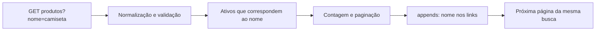

# Aula 6.83 — Revisão do filtro por nome e dos links

Revisão, explicação e verificação em 01/11/2026 após confirmação da 6.82 com
"entendi" e publicação em 50af388063efbc3bf253ac3bdbd8bb0010c83b9f.
Entendimento da 6.83 confirmado com "entendi" em 01/11/2026; publicação em preparação.

## Objetivo e caminho

Relacionar o filtro por nome com a navegação entre páginas da mesma busca.
Acrescentamos esta aula e os registros; código executável, scripts e OpenAPI
permanecem como estavam.



## Entrada normalizada e validada

[ListarProdutosRequest](../../backend/app/Http/Requests/ListarProdutosRequest.php)
usa as regras bail/sometimes/required/string/max:100 para nome. O campo pode
ser omitido; quando enviado, deve ser texto não vazio de até 100 caracteres.
O método nome() devolve o nome validado ou null quando omitido.

Os middlewares padrão de
[normalização de entrada do Laravel](https://laravel.com/docs/13.x/requests#input-trimming-and-normalization)
removem espaços externos e convertem texto vazio para null antes da validação.
Assim, nome com apenas espaços falha em required. A caixa enviada é preservada
no valor normalizado: '  CAMISETA  ' torna-se 'CAMISETA'. Os casos inválidos
foram revistos pelas regras/contrato; não reexecutamos esses cenários nesta aula.

## Como o nome chega à consulta

O [controller](../../backend/app/Http/Controllers/Api/V1/ProdutoController.php)
entrega a página e o nome validados ao catálogo:

```php
$paginacao = $catalogo->paginarProdutos($request->pagina(), $request->nome());
```

Em [CatalogoEloquent](../../backend/app/Services/CatalogoEloquent.php), o trecho
que prepara a consulta é:

```php
$consulta = Produto::query()
    ->where('status', 'ativo');

if ($nome !== null) {
    $consulta->whereRaw('CHARINDEX(?, [nome]) > 0', [$nome]);
}
```

Os produtos precisam ser ativos. Quando há nome, CHARINDEX procura esse trecho
na coluna nome; a [documentação do SQL Server](https://learn.microsoft.com/en-us/sql/t-sql/functions/charindex-transact-sql?view=sql-server-ver16)
explica que o resultado é 0 quando o trecho não é encontrado. O teste > 0 mantém
as correspondências. O valor é passado pelo parâmetro ? com [$nome].
Sem nome, o bloco opcional é pulado e a consulta continua com os ativos.

Depois vêm orderBy nome/id e paginate 10. Portanto, o filtro participa da
consulta antes da contagem e do recorte da página. Meta.total corresponde aos
produtos dessa busca, e count(data) corresponde aos itens daquela página.

## Como o nome permanece nos links

No controller, depois de obter o paginador:

```php
$paginacao->appends($request->safe()->only(['nome']));
```

Safe fornece os dados validados; only seleciona nome. Appends acrescenta esse
valor à query string dos links gerados, conforme a
[documentação de paginação](https://laravel.com/docs/13.x/pagination#appending-query-string-values).
Parâmetros desconhecidos não entram nessa seleção. O paginador continua
responsável pelo número da página nas URLs.

A consulta escolhe os produtos; appends mantém a busca na navegação. Por exemplo:

```text
/api/v1/produtos?nome=camiseta&page=1
/api/v1/produtos?nome=camiseta&page=2
```

A segunda URL pode ser usada diretamente pelo cliente. No teste, seguimos
exatamente a URL recebida:

```php
$segunda = $this->getJson($primeira->json('links.next'));
```

ProdutoResource::collection apresenta os produtos em data e as informações
paginadas em links/meta, incluindo as opções de meta.links.

## Verificação acompanhada

Executamos somente os testes existentes pertinentes, sem flags de captura:

```sh
docker compose exec -T backend php artisan test --do-not-cache-result \
  --filter='test_filtra_ativos_por_trecho_do_nome_no_json|test_mantem_filtro_e_total_ao_seguir_proxima_pagina'
```

Exec usa o backend existente, -T dispensa terminal interativo e a opção de cache
evita escrever em /app somente leitura. O filtro com | seleciona os dois
métodos; o primeiro recebe três entradas do DataProvider. Resultado: 4 testes/
89 asserções, código 0.

| Cenário existente | O que as asserções conferem |
| --- | --- |
| nome=camiseta | Camiseta azul e Kit de camiseta; Caneca e Camiseta inativa ficam fora |
| nome=%20%20CAMISETA%20%20 | Mesmos produtos; CAMISETA sem espaços externos nos links |
| nome=camiseta&ignorado=valor | Busca mantida; somente nome e page nos links |
| Seguir links.next | Primeira página com 10 itens, segunda com 2; total filtrado 12 nas duas |

O cenário paginado tem 12 produtos ativos correspondentes, além de Canecas e
uma Camiseta inativa. O teste também confere os links e as opções meta.links
nas duas páginas, incluindo o desempate por ID. Todos os IDs vêm de factories.

Hashes das quatro capturas existentes foram comparados antes/depois e
permaneceram iguais. Não houve nova captura nem execução Redocly nesta revisão;
o comando de contratos mantém seus casos já definidos. SELECTs após:
loja/loja_app 0 categorias/1 produto; loja_test/loja_testes 0 categorias/0 produtos.
Diff/links conferidos; backend/scripts/OpenAPI/configuração/Compose/README e
dependências intactos. Sem nova suíte completa; última 6.76, 66/620. Limite do
validador da 6.64 continua registrado. Contrato do filtro em [OpenAPI](../api/openapi.json).

## Continuidade

Aula anterior registra publicação da 6.82; catálogo/roteiro/progresso atualizados.
Entendimento confirmado com "entendi" em 01/11/2026; publicação em preparação.
Depois de publicar, iniciar somente 6.84: consolidar a revisão e as pendências do módulo 6,
sem iniciar outro módulo. Exercício DBeaver continua sem relato do aluno.
