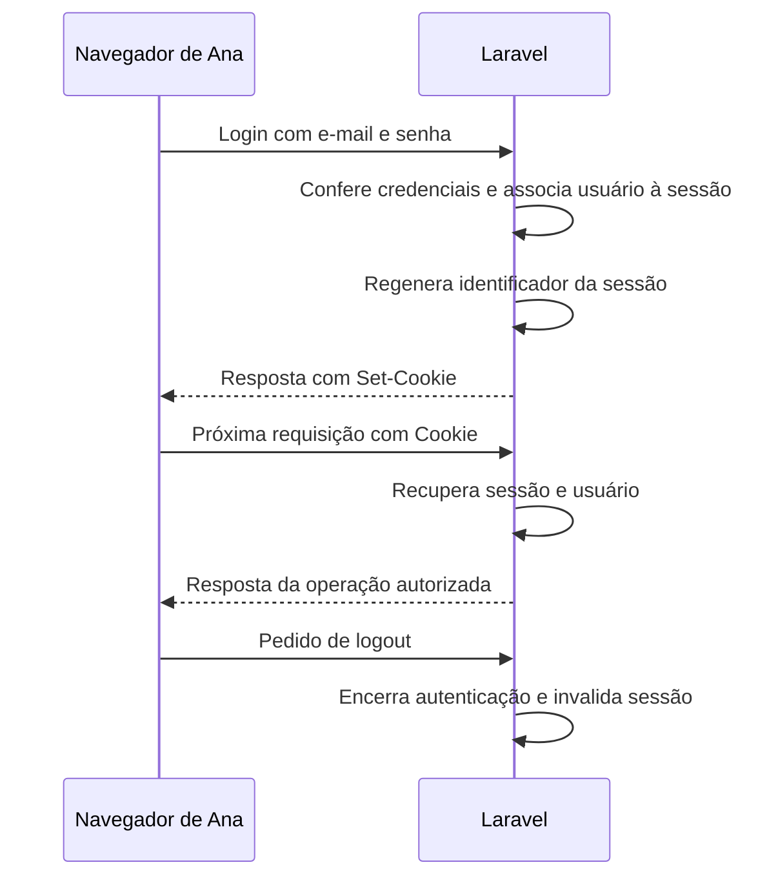

# Aula 7.8 — Sessão e cookie no fluxo de login

Apresentada e verificada por leitura/configuração em 03/11/2026, após confirmação
da 7.7 com "entendi". Checkpoint anterior publicado e conferido em
e21e732313d14de2c8e78212ca4c4ee18df44cb9; HEAD/origin/main/main remota iguais
após push. Entendimento da 7.8 confirmado com "entendi" em 03/11/2026.

## Objetivo

Entender como reconhecer o usuário na próxima requisição, depois do login.
O fluxo abaixo é planejado; ainda não criamos rotas de login/logout nem
instalamos Sanctum. Nesta aula alteramos somente documentação.

HTTP trata requisições como interações independentes. Ao enviar outra
requisição, o navegador precisa fornecer algo que permita ao servidor retomar
o contexto da sessão. No mecanismo estudado, o cookie faz essa ligação.

| Peça | Onde fica no mecanismo atual | Responsabilidade |
| --- | --- | --- |
| Sessão | No servidor, com driver file | Guardar dados entre requisições, incluindo a identificação do usuário após autenticar |
| Cookie de sessão | No navegador | Levar nas requisições um valor que referencia a sessão |
| Registro User | No SQL Server, quando cadastrado | Persistir dados do usuário e hash da senha |

O identificador da sessão é diferente do ID do usuário. O cookie de sessão
não precisa carregar a senha, seu hash ou o cadastro completo. Uma sessão
pode existir para um visitante: a mera presença de cookie não prova login.

A ideia de manter dados entre requisições se parece com o uso de $_SESSION
em PHP tradicional; Laravel gerencia sessões com componentes e drivers próprios.

## Exemplo da cliente Ana



Set-Cookie é o cabeçalho de resposta que instrui o navegador a guardar ou
atualizar um cookie. Cookie é o cabeçalho de requisição usado para enviá-lo
de volta quando as regras do navegador permitirem. Não reenviamos a senha
em cada operação. A configuração de domínios e envio entre frontend/backend
será estudada quando introduzirmos essa integração.

Depois de autenticar, regenerar o identificador troca a referência da sessão,
ajudando a evitar fixação de sessão. Nas próximas requisições, o guard pode
obter da sessão a identificação do usuário e recuperá-lo pelo provider.
A autorização continua decidindo se esse usuário pode executar a operação.

No logout, encerramos a autenticação e invalidamos a sessão atual. Apagar
apenas o nome exibido na interface não encerra a autenticação no servidor.
A implementação e a proteção das requisições de login/logout serão estudadas
em etapas próprias. Nenhuma dessas ações foi executada nesta aula.

## Ligação com os arquivos existentes

Em [config/auth.php](../../backend/config/auth.php), o guard padrão carregado
é web, com driver session e provider users. Essa configuração informa como
autenticar; não cria uma rota nem inclui automaticamente os middlewares de
sessão em qualquer endpoint.

Em [config/session.php](../../backend/config/session.php), driver define onde
guardar os dados. No ambiente normal carregado, file usa
storage/framework/sessions. O cookie se chama loja-fullstack-session e a opção
http_only está true. HttpOnly restringe acesso ao cookie por JavaScript;
o navegador ainda pode enviá-lo em requisições HTTP.

A tabela sessions criada em loja_test na 7.4 não obriga usar o banco para
sessões. O ambiente de testes está configurado com array em
[phpunit.xml](../../backend/phpunit.xml) e no
[modelo de ambiente](../../backend/.env.testing.example), para armazenamento
em memória. Criar a tabela e selecionar o driver são decisões distintas.

As rotas de [web.php](../../backend/routes/web.php) usam o grupo web. A rota
/loja acrescenta MarcarRespostaCurso. No kernel HTTP carregado, o grupo web
contém EncryptCookies, AddQueuedCookiesToResponse, StartSession,
ShareErrorsFromSession, PreventRequestForgery e SubstituteBindings.
StartSession participa do carregamento e salvamento da sessão da requisição.

As rotas de [api.php](../../backend/routes/api.php) usam api, cujo grupo atual
contém somente SubstituteBindings. Não há StartSession ali. Essa é a
configuração atual, antes da integração com Sanctum. As leituras do catálogo
continuam públicas.

## Verificações e limites

```sh
docker compose exec -T backend php artisan route:list --path=loja -vv --no-ansi
docker compose exec -T backend php artisan route:list --path=api/v1 -vv --no-ansi
```

Route:list selecionou uma rota /loja com web/MarcarRespostaCurso e duas rotas
da API com api, códigos 0. Nessa execução de console, mostrou os nomes dos
grupos. Um diagnóstico PHP separado carregou o kernel HTTP e consultou
getMiddlewareGroups para conferir a composição efetiva descrita acima.

Outro diagnóstico de configuração em PHP Docker confirmou guard web/session/
users, driver de sessão file, nome do cookie e HttpOnly true, com sessão não
iniciada. Não exibimos valores de cookies ou conteúdo de sessões. Não atendemos
uma requisição HTTP, não iniciamos sessão nem autenticamos usuário.

Sem alteração de aplicação, dependências, configuração, rotas ou bancos.
Não executamos nova suíte; último resultado completo: 7.7, 67 testes/
635 asserções. A verificação desta aula confirma configuração e grupos de
middleware, não um fluxo real de autenticação no navegador.

Fontes: [sessões no Laravel](https://laravel.com/docs/13.x/session),
[login e regeneração](https://laravel.com/docs/13.x/authentication#manually-authenticating-users),
[logout](https://laravel.com/docs/13.x/authentication#logging-out) e
[cookies HTTP](https://developer.mozilla.org/en-US/docs/Web/HTTP/Guides/Cookies).

## Continuidade

Entendimento confirmado com "entendi" em 03/11/2026. Próximo passo após publicar:
7.9 — entender proteção CSRF no fluxo autenticado por sessão/cookie, antes de
instalar Sanctum. Checkpoint publicado e conferido em
c5008fd56cd102cc5d24ce295d29a25a5f068f6e; HEAD/origin/main/main remota iguais
após push. Registro posterior à publicação.
